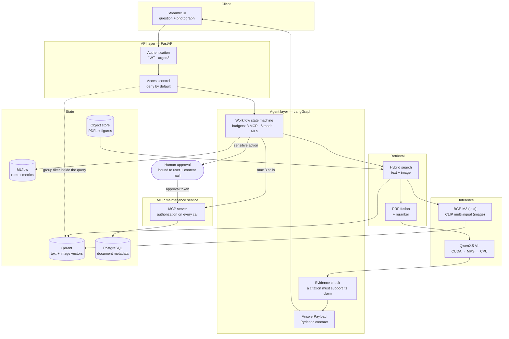

[](https://www.python.org/)
[](https://pytorch.org/)
[](https://opensource.org/licenses/MIT)
[](https://huggingface.co/carteeeltheboss)

# MaintiDoc

**A multimodal, agentic maintenance-documentation assistant with verifiable citations.**

A technician photographs a control panel and asks what an indicator light means. MaintiDoc
retrieves the relevant passages and figures from authorized maintenance manuals, reads the
photograph with a vision-language model, answers **with page-level citations**, and — if the
technician asks — prepares a maintenance ticket that a human must approve before it is created.

It is a documentation aid. It controls no equipment, never guarantees a diagnosis, and never
replaces safety procedures or a qualified technician. See [`docs/SPEC.md`](docs/SPEC.md) §1.

---

## Project status

This is an in-progress school project, and the README says plainly what runs today.

| Area | State |
|---|---|
| Contracts, security primitives, prompts, device selection, corpus generation | **built and tested** (259 tests, `mypy --strict`, `ruff`) |
| Ingestion, embeddings, vector index, retrieval, MCP server, workflow, API, UI, Docker | **not built yet** — tracked in [`docs/STATUS.md`](docs/STATUS.md) |
| Qwen2.5-VL-7B inference | **never executed**; VRAM figures are estimates pending the SPEC §11 benchmark |
| Object storage backend | **undecided** — MinIO is no longer pullable, see [ADR 0006](docs/decisions/0006-object-storage-pending.md) |

Nothing below is presented as working when it is not. `docs/STATUS.md` carries the same
information for a cold-start reader, including a list of what has *not* been verified.

---

## Architecture



### The trust boundary that matters

Retrieved text is **data, never instructions**. Retrieved passages are rendered into delimited
tags, declared as `untrusted_variables` in the prompt file, and the loader **refuses to load a
prompt** that declares untrusted input without delimiting it. A document that says *"ignore
previous instructions"* is quoted, not obeyed.

```text
question + photo
      │
      ▼
 authenticate ──► resolve groups ──► filter applied INSIDE the vector query
      │                                            │
      ▼                                            ▼
 LangGraph node ──► retrieve text + figures ──► RRF fusion ──► rerank
      │
      ├──► consult history over MCP (authorized server-side, ≤ 3 calls)
      │
      ├──► VLM reads the photograph ──► visual observation (no diagnosis)
      │
      ├──► build answer ──► verify every citation against the retrieved element
      │
      ▼
 AnswerPayload  ── answered │ needs_clarification │ abstained │ needs_approval
                                  │                     │              │
                        ask a precise question   state what is missing   human approves
                                                                        exact content
```

### Component responsibilities

| Layer | Responsibility | Key rule |
|---|---|---|
| Streamlit UI | Question + photo upload, answer, citations, approval screen | Never displays a model-invented confidence value |
| FastAPI | Authentication, access filtering on every endpoint, upload limits | Every endpoint checks group access, not just retrieval |
| LangGraph workflow | SPEC §6 node sequence, loop limits, human-approval interrupt | Budgets enforced in code: 3 MCP calls, 6 model calls, 60 s |
| Retrieval | Text and image search, RRF fusion, reranking | The access filter is part of the query, not a post-filter |
| Inference | Qwen2.5-VL answers; BGE-M3 and CLIP embed | Device probed at runtime; any model step-down is logged and reported |
| MCP server | Equipment history and ticket creation | Authorization re-checked on **every** call |
| Qdrant / PostgreSQL / object store | Vectors, metadata, original files | Element metadata carries document id, version, page, equipment family, access groups |
| MLflow | Run tracking | Every run records model, prompt, reranker and index versions |

---

## Technologies

Pinned versions below are the ones actually resolved and exercised in this repository. Exact
pins live in the lockfile; `pyproject.toml` carries lower bounds only.

| Technology | Version | Role | State |
|---|---|---|---|
| Python | 3.11+ (3.12 tested) | Runtime | in use |
| FastAPI + Uvicorn | 0.162 / 0.54 | HTTP API | dependency wired, app not written |
| Pydantic v2 | 2.14 | Output contract, validation | **in use** |
| LangChain Core | 1.7 | Prompt templating | **in use** |
| LangGraph | 1.2 | Agent state machine, approval interrupt | dependency wired, graph not written |
| MCP SDK | 2.3 | Maintenance service protocol | contracts only |
| Qdrant + qdrant-client | server v1.20 / client 1.20 | Vector search | dependency wired |
| BGE-M3 | `BAAI/bge-m3` | Multilingual text embeddings | not exercised |
| CLIP multilingual | CLIP-compatible | Text↔image retrieval | not exercised |
| Qwen2.5-VL | 7B-Instruct-AWQ (fallback 3B) | Vision-language model | **never loaded yet** |
| PyTorch + Transformers | torch 2.5+, transformers 4.49+ | Inference | optional `ml` extra |
| PyMuPDF | 2.0 (MuPDF 1.28.5) | PDF extraction and authoring | **in use** |
| Tesseract via pytesseract | pytesseract 0.3.13 | Local OCR for scanned documents | not exercised (binary absent on the dev host) |
| PostgreSQL + SQLAlchemy | 16.15 / 2.1 | Document metadata | dependency wired |
| MinIO / S3 API | client `minio` 7.2; **server undecided** | Object storage | **blocked**, ADR 0006 |
| Streamlit | — | Web UI | **not yet a dependency**; UI not written |
| MLflow | 2.x | Experiment tracking | optional `tracking` extra, not exercised |
| Docker Compose | v5.5 (host) | Deployment | no compose file written yet |
| ruff / mypy / pytest / nox | 0.17 / 2.4 / 9.2 / 2026.10 | Lint, types, tests, task runner | **in use** |

---

## Quickstart

### Windows (no GNU make required)

```bat
python -m venv .venv
.venv\Scripts\pip install -e ".[dev]"

.venv\Scripts\nox -s check          :: ruff + mypy --strict + tests
.venv\Scripts\maintidoc doctor      :: what this machine can actually run
```

`doctor` reports the detected device, free VRAM, what the model ladder decided **and why**,
which prompt versions exist, whether the corpus is present, and whether the services are
reachable — with an explicit `ok` / `warn` / `fail` per check.

### Linux, macOS, WSL, CI

```bash
make install
make check      # ruff + mypy --strict + pytest
make doctor
```

`make` and `nox` run the same sessions; `noxfile.py` is the single source of truth
([ADR 0002](docs/decisions/0002-task-runner.md)).

### Generate the document corpus

```bash
python scripts/generate_corpus.py            # 34 synthetic documents, 2 equipment families
python scripts/generate_corpus.py --count 8  # quick smoke test
```

Seeded, so the same commit always produces the same corpus — a precondition for the evaluation
numbers to mean anything. The corpus deliberately contains one document with a **zero-length
text layer** (OCR is the only way to read it), one restricted to a `supervisors` group, and one
carrying the SPEC §9 prompt-injection sentence. Only `corpus/manifest.json` is committed.

---

## Security model

The guarantees are structural, not aspirational — each is enforced by code and pinned by a test.

| Guarantee | Mechanism | Test |
|---|---|---|
| No retrieval without an access filter | Filter applied inside the vector query as `must`; deny by default, so an unlabelled document is visible to **nobody** | `tests/test_security_access.py` |
| No ticket without human approval | Approval token is a signed JWT bound to the user **and** a sha256 of the exact content; single-use, so a replay fails; an edit invalidates it | `tests/test_security_approval.py` |
| No citation that was not retrieved | Citations are built from the retrieved element itself; the render/parse round-trip means nothing else can produce one | `tests/test_retrieval_render.py` |
| No fabricated confidence score | `extra="forbid"` on every schema; a test audits the contract for such a field | `tests/test_schemas.py` |
| Documents are data, never instructions | Prompt loader rejects any prompt that does not delimit its untrusted inputs | `tests/test_prompts.py` |
| No secrets in git or logs | Secret values are `SecretStr`, a redaction filter scrubs them from log records, gitleaks runs pre-commit and in CI | `.pre-commit-config.yaml` |
| No silent model substitution | The resolver returns an audit trail; the model that actually answered is recorded in every response's provenance | `tests/test_runtime_devices.py` |

---

## Repository layout

```text
.
├── src/maintidoc/
│   ├── schemas.py            SPEC §7 output contract — the only response shape
│   ├── domain.py             DocumentRecord, Element, RetrievedElement
│   ├── config.py             Environment settings; secrets are SecretStr
│   ├── observability.py      Secret redaction, access events, safe logging
│   ├── errors.py             Domain errors with safe, content-free messages
│   ├── security/
│   │   ├── access.py         Deny-by-default identity and access filtering
│   │   └── approval.py       Content-bound approval tokens, replay protection
│   ├── runtime/devices.py    CUDA → MPS → CPU probe and the model fallback ladder
│   ├── prompts/loader.py     Versioned prompt loading + injection guard
│   ├── retrieval/render.py   Source rendering and parsing (one format, both ways)
│   ├── vlm/                  Provider protocol + deterministic stub
│   ├── agent/drafts.py       Lenient model output vs strict API contract
│   ├── mcp/contracts.py      Typed maintenance-service tool signatures
│   ├── storage/objects.py    ObjectStore interface + filesystem backend
│   └── cli.py                doctor, version
├── prompts/                  Versioned prompt YAML — never inline prompts in code
├── scripts/generate_corpus.py
├── tests/                    259 tests, no GPU and no torch required
├── docs/
│   ├── SPEC.md               Source of truth (French)
│   ├── ARCHITECTURE.md       What is built, trust boundaries, deviations
│   ├── STATUS.md             Cold-start state: done / next / blockers / unverified
│   ├── decisions/            ADRs
│   └── sessions/             Session logs
├── noxfile.py                Task runner — source of truth for commands
├── Makefile                  Thin wrapper so `make check` still works
└── docker-compose.yml        (not yet written)
```

---

## Development

```bash
nox -s lint      # ruff check + format --check
nox -s format    # apply fixes
nox -s types     # mypy --strict on src/
nox -s test      # unit tests, no services, no GPU, no torch
nox -s check     # lint + types + test  ← the gate before every commit
nox -s corpus    # regenerate the synthetic corpus
nox -s doctor    # device / VRAM / service readiness
```

Read [`AGENTS.md`](AGENTS.md) first if you are an LLM working in this repository, then
[`docs/STATUS.md`](docs/STATUS.md). Decisions are recorded in [`docs/decisions/`](docs/decisions/):
the repo is the only memory across sessions.

---

## Limitations and non-goals

- **Out of scope by design** (SPEC §2): driving equipment, guaranteed diagnosis, autonomous
  intervention.
- The VLM has not been benchmarked. On the development machine (RTX 4070 Laptop, 8 GB VRAM) the
  7B in 4-bit does not fit alongside the desktop, so the runtime steps down to the 3B and says
  so. See [ADR 0003](docs/decisions/0003-model-fallback-ladder.md).
- The evaluation set does not exist yet. SPEC §10's targets are *proposed*, not achieved.
- The corpus is synthetic. It is realistic enough to exercise retrieval, OCR and access control,
  and it is not real maintenance documentation.
- No fine-tuning has been attempted (SPEC §5); SPEC §3's fine-tuned reranker is future work.

---

## License

MIT — see [`LICENSE`](LICENSE).
