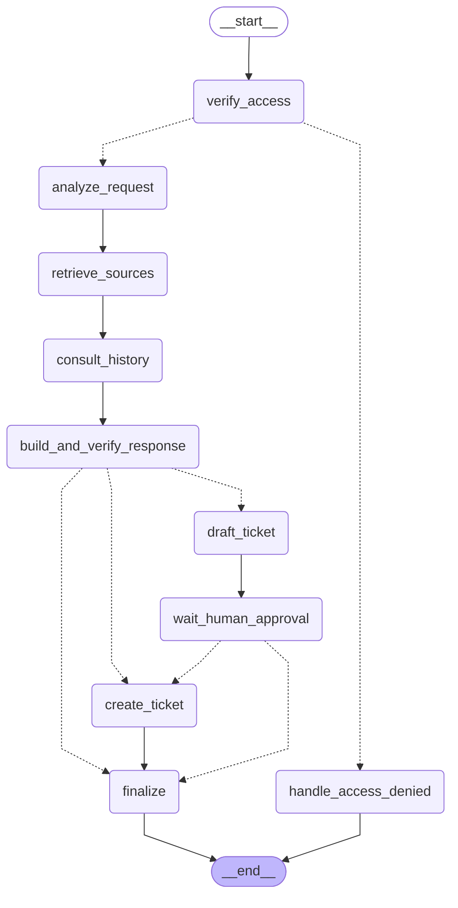

# LangGraph Workflow State Machine (SPEC §6)

This document visualizes the compiled LangGraph workflow state machine executing the
SPEC §6 node sequence, access checks, history consultation, and human-approval interrupt.

## Node Flow Description

1. **`verify_access`**: Evaluates principal status (`is_active`, group presence) and enforces image size limits.
2. **`handle_access_denied`**: Short-circuits unauthorized requests directly to `END` with `AnswerStatus.ABSTAINED` without leaking sources or consuming model calls.
3. **`analyze_request`**: Performs visual analysis with `visual_analysis_v1` prompt when an image is present, detecting visual features and identifying equipment.
4. **`retrieve_sources`**: Executes access-filtered hybrid search (`HybridRetriever`) combining dense BGE-M3 text and CLIP image vectors via RRF fusion.
5. **`consult_history`**: Only invoked when equipment context is required (failure history, previous interventions, or ticket request), querying MCP tools `get_equipment_history` and `get_open_tickets`.
6. **`build_and_verify_response`**: Formats versioned `answer_v1` prompt, calls VLM provider, parses lenient draft, and verifies citations against actually retrieved elements (AGENTS.md NEVER #5).
7. **`draft_ticket`**: Formats candidate maintenance ticket, computes canonical content hash (`canonical_content_hash`) and derives idempotency key (`derive_idempotency_key`), yielding `TicketProposal`.
8. **`wait_human_approval`**: Interrupt / pause state awaiting human approval token bound to user + content hash (SPEC §6).
9. **`create_ticket`**: Calls MCP tool `create_ticket` with verified approval token, creates or deduplicates ticket, and returns confirmation.
10. **`finalize`**: Assembles final `AnswerPayload` ensuring all status invariants are satisfied.
