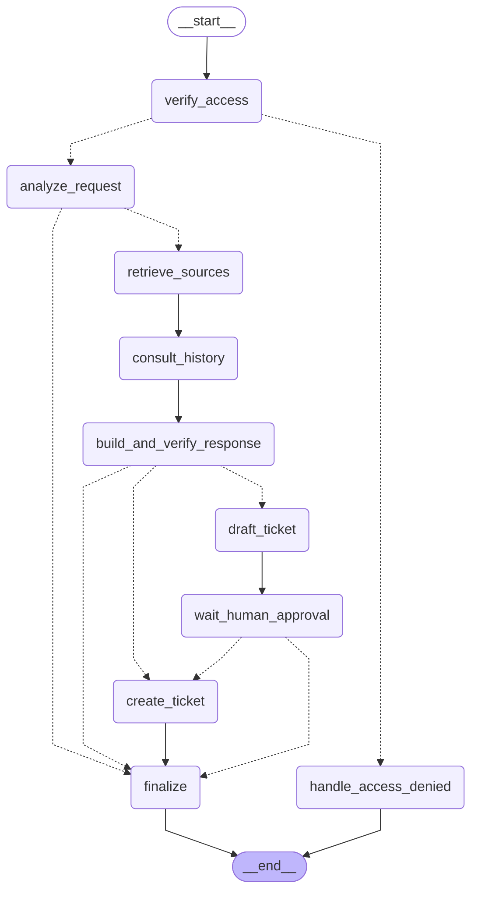

# LangGraph Workflow State Machine (SPEC §6)

This document visualizes the compiled LangGraph workflow state machine executing the
SPEC §6 node sequence, access checks, history consultation, and human-approval interrupt.

## Node Flow Description

1. **`verify_access`**: Evaluates principal status and enforces image limits.
2. **`handle_access_denied`**: Short-circuits unauthorized requests to `END`.
3. **`analyze_request`**: Visual analysis with `visual_analysis_v1` when image present.
4. **`retrieve_sources`**: Access-filtered hybrid search (`HybridRetriever`).
5. **`consult_history`**: Consults MCP history and ticket tools when needed.
6. **`build_and_verify_response`**: Inference, draft parsing, and citation check.
7. **`draft_ticket`**: Formats candidate ticket, computes hash and idempotency key.
8. **`wait_human_approval`**: Interrupt state awaiting bound approval token.
9. **`create_ticket`**: Calls MCP tool `create_ticket` with verified approval token.
10. **`finalize`**: Assembles final `AnswerPayload` ensuring all invariants hold.
